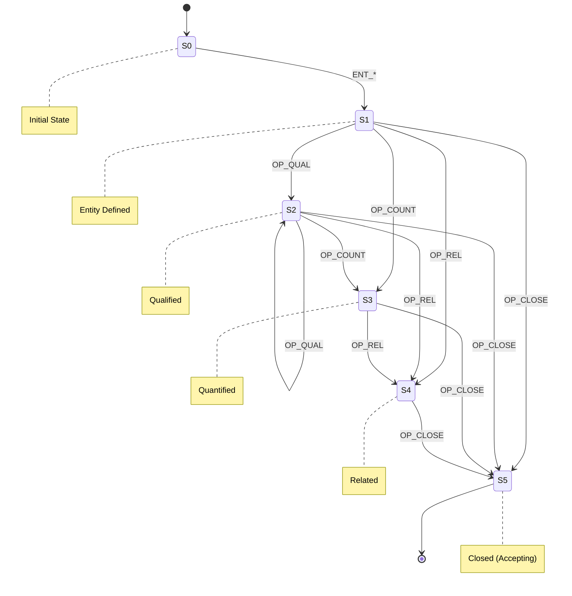

# Indus Script Automaton State Diagram

## Visual Representation



## ASCII Representation

```
┌─────────────────────────────────────────────────────────────────┐
│           Indus Script Finite Automaton (ASCII)                 │
└─────────────────────────────────────────────────────────────────┘

        ENT_*
   ┌─────────────┐
   │             v
 [*]──> S0       S1 ─────OP_QUAL────> S2
     INICIAL     │  ─────OP_COUNT───> │ │
                 │  ─────OP_REL─────> S3 │
                 │                     │  │
                 └────OP_CLOSE────────┴──┴──> S4 ──OP_CLOSE──> ((S5))
                                              │                FECHADA
                                              └──OP_CLOSE─────> [*]

Legend:
  [*]    = Start/End
  S0-S4  = States
  ((S5)) = Accepting State
  ENT_*  = Any Entity Class

```

## Transition Table

```
Transition Table δ(state, symbol) → new_state
======================================================================

State      | ENT  | QUAL | COUNT | REL  | CLOSE 
-----------+------+------+-------+------+-------
S0 (INIT)  | S1   |  -   |   -   |  -   |   -   
S1 (ENT)   |  -   | S2   |  S3   | S4   |  S5   
S2 (QUAL)  |  -   | S2   |  S3   | S4   |  S5   
S3 (QUANT) |  -   |  -   |   -   | S4   |  S5   
S4 (REL)   |  -   |  -   |   -   |  -   |  S5   
S5 (CLOSE) |  -   |  -   |   -   |  -   |   -   

Legend:
  S#   = State number
  -    = Invalid transition
  S5   = Accepting state (FECHADA/CLOSED)

```

## State Descriptions

### S0: INICIAL (Initial)
- Entry point of the automaton
- Accepts: Entity symbols to transition to S1
- Rejects: Any non-entity symbol

### S1: ENTIDADE DEFINIDA (Entity Defined)
- An entity has been recognized
- Accepts: Qualifiers (S2), Counts (S3), Relations (S4), Closure (S5)
- Most versatile state with multiple exit paths

### S2: QUALIFICADA (Qualified)
- Qualification operators have been applied
- Accepts: More qualifiers (S2), Counts (S3), Relations (S4), Closure (S5)
- Allows iterative qualification

### S3: QUANTIFICADA (Quantified)
- Quantity has been specified
- Accepts: Relations (S4), Closure (S5)
- Cannot return to qualification

### S4: RELACIONADA (Related)
- Relations have been established
- Accepts: Only Closure (S5)
- Penultimate state before acceptance

### S5: FECHADA (Closed) ★ ACCEPTING STATE
- Closure operator applied
- Accepting state - sequence is complete and valid
- No outgoing transitions (absorbing state)

## Symbol Classes

- **ENT_***: Entity classes (OVAL, U, HASTE, ANIMAL, METRICA)
- **OP_QUAL**: Qualification operators (Dot, Stroke, etc.)
- **OP_COUNT**: Counting operators (410-417)
- **OP_REL**: Relation operators (400-409)
- **OP_CLOSE**: Closure operators (342-348)
